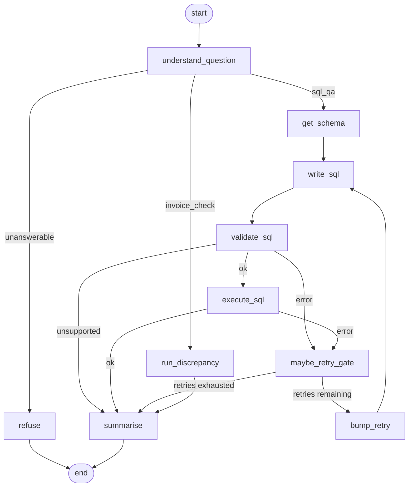

# Shipping Data Agent

AI agent for shipment Q&A and invoice error checks.

## Layout

```
src/shipping_data_agent/   # Python package
  agent/                   # LangGraph graph (Step 5)
  eval/                    # 15-question bank + grading harness (Step 6)
  tools/                   # Read-only SQL / schema / discrepancy tools
  etl/                     # Cleaning + DuckDB load
scripts/                   # Data generation, ETL, ask_agent, run_eval
data/raw/                  # Source CSVs (Step 2)
data/warehouse/            # DuckDB warehouse (Step 3)
data/eval/                 # Eval results JSON
tests/                     # Pytest suite
```

## Quick start

```bash
python3 -m venv .venv
make setup
make data    # regenerate synthetic CSVs under data/raw/ (seed=42)
make etl     # clean + load DuckDB warehouse under data/warehouse/
make test
make eval    # SQL ground truth always; live agent scoring when .env has keys
```

Copy `.env.example` → `.env` and set `ANTHROPIC_API_KEY` or `OPENAI_API_KEY` (plus optional `LLM_PROVIDER=anthropic|openai`). Keys are never hardcoded.

### Ask a sample question (Step 5)

```bash
# Invoice discrepancy route
make ask Q='Find invoice discrepancies and summarise the error types'

# SQL analytics route
.venv/bin/python scripts/ask_agent.py "How many shipments were delivered to Germany?"

# Print the compiled graph as Mermaid
.venv/bin/python scripts/ask_agent.py --print-diagram
```

Or from Python:

```python
from shipping_data_agent.agent import ask
print(ask("What is the average delivery days by carrier?"))
```

### Raw CSVs (`data/raw/`)

| File | Role |
|------|------|
| `shipments.csv` | ~20k shipments (`id`, `date`, `carrier`, `country`, `weight_kg`, `parcel_type`, `status`, `delivery_days`) |
| `carriers.csv` | Carrier master data |
| `contract_rates.csv` | Contract rates by carrier / country / weight band |
| `carrier_invoices.csv` | Carrier bills (`shipment_id`, `carrier`, `billed_price`, `invoice_date`) |
| `carrier_invoices_labeled.csv` | Same invoices plus `error_type` labels (reference; eval uses warehouse SQL) |

Roughly 3% of invoices carry deliberate faults: duplicate billing, wrong weight class, price above contract, or a billed shipment that does not exist. ETL keeps those rows so later agent tools can discover them; only structural bad data is rejected.

### Warehouse (`data/warehouse/`)

| Artifact | Role |
|----------|------|
| `shipping.duckdb` | Star schema: `fact_shipments`, `fact_invoices`, `fact_contract_rates`, `dim_carrier`, `dim_country`, `dim_date` |
| `rejected_rows.csv` | Rows dropped during cleaning (`_source`, `_reason`, `_row_number` + original columns) |

`make etl` is idempotent (tables are replaced each run).

### Agent tools (`src/shipping_data_agent/tools/`)

| Tool | Role |
|------|------|
| `run_sql(query)` | Single read-only `SELECT` / `WITH … SELECT`; rejects writes & multi-statements; row limit + timeout |
| `get_schema()` | Table/column descriptions for the star schema |
| `find_invoice_discrepancies()` | Curated SQL for the four injected invoice faults; returns a summary table |

```bash
.venv/bin/python -c "from shipping_data_agent.tools import find_invoice_discrepancies; print(find_invoice_discrepancies())"
```

### LangGraph agent (`src/shipping_data_agent/agent/`)

Explicit nodes:

1. **understand_question** — classify as `invoice_check`, `sql_qa`, or `unanswerable`
2. **run_discrepancy** — invoice audits call `find_invoice_discrepancies`
3. **get_schema → write_sql → validate_sql → execute_sql** — analytics path using Step 4 tools
4. **maybe_retry_gate / bump_retry** — on SQL guard or execution errors, retry writing SQL up to **2** times with the error message
5. **summarise** — plain-English answer; SQL analytics answers always show the SQL used
6. **refuse** — if the question cannot be answered from the warehouse, say so (no guessing)

Compiled graph (from `export_graph_mermaid()` / `scripts/ask_agent.py --print-diagram`):



## Evaluation (Step 6)

Fifteen fixed questions with answers computed directly in SQL against DuckDB. The harness runs the LangGraph agent (when LLM keys are set), grades free-text answers against those ground-truth values, and reports accuracy, failed cases, and average SQL retries.

### How to run

```bash
cp -n .env.example .env   # set ANTHROPIC_API_KEY or OPENAI_API_KEY
make etl                 # ensure warehouse exists
make eval                # live agent scoring when keys present
# or ground-truth only (no LLM):
.venv/bin/python scripts/run_eval.py --ground-truth-only
```

Results JSON: `data/eval/results.json` (last run: `2026-10-30T15:50:57.989695+00:00`).

### Latest metrics

Live agent scoring was **not** run (no `ANTHROPIC_API_KEY` / `OPENAI_API_KEY` in `.env`). Question bank + SQL ground truth are shipped; re-run `make eval` after adding keys to fill accuracy / retries.

| Metric | Value |
|--------|-------|
| Questions | 15 |
| Accuracy | _pending live run_ |
| Failed | _pending live run_ |
| Average SQL retries | _pending live run_ |
| LLM configured | False |

### Question bank (SQL ground truth)

| ID | Intent | Question | Expected (from DuckDB) |
|----|--------|----------|------------------------|
| `q01_shipment_count` | sql_qa | How many shipments are in the warehouse? | `20000` |
| `q02_delivered_germany` | sql_qa | How many shipments were delivered to Germany? | `1472` |
| `q03_invoice_count` | sql_qa | How many invoices are there? | `19679` |
| `q04_total_billed` | sql_qa | What is the total billed amount across all invoices in EUR, rounded to 2 decimal places? | `624580.26` |
| `q05_avg_delivery_by_carrier` | sql_qa | What is the average delivery_days by carrier, excluding cancelled shipments, rounded to 2 decimals? | `carrier_id=DHL, avg_delivery_days=6.68; carrier_id=FDX, avg_delivery_days=6.57; carrier_id=GLS, avg_delivery_days=6.65; carrier_id=TNT, avg_delivery_days=6.6; carrier_id=UPS, avg_delivery_days=6.56` |
| `q06_top_carriers_by_shipments` | sql_qa | List the top 5 carriers by shipment count with their counts. | `carrier_id=FDX, shipment_count=4068; carrier_id=TNT, shipment_count=4002; carrier_id=UPS, shipment_count=3998; carrier_id=DHL, shipment_count=3979; carrier_id=GLS, shipment_count=3953` |
| `q07_delayed_count` | sql_qa | How many shipments have status delayed? | `1437` |
| `q08_avg_weight` | sql_qa | What is the average shipment weight_kg, rounded to 2 decimals? | `16.74` |
| `q09_carrier_dim_count` | sql_qa | How many carriers are in the carrier dimension? | `5` |
| `q10_shipments_2024` | sql_qa | How many shipments were shipped in calendar year 2024? | `10109` |
| `q11_dhl_invoices` | sql_qa | How many invoices were billed by DHL? | `3929` |
| `q12_top_parcel_type` | sql_qa | What is the most common parcel_type and how many shipments use it? | `parcel_type=medium_box, n=5981` |
| `q13_max_weight` | sql_qa | What is the maximum shipment weight_kg, rounded to 2 decimals? | `119.99` |
| `q14_contract_rate_rows` | sql_qa | How many contract rate rows are in the warehouse? | `250` |
| `q15_invoice_discrepancies` | invoice_check | Find invoice discrepancies and report the count for each error type (duplicate_billing, wrong_weight_class, price_above_contract, nonexistent_shipment). | `duplicate_billing=292, nonexistent_shipment=145, price_above_contract=145, wrong_weight_class=146` |
