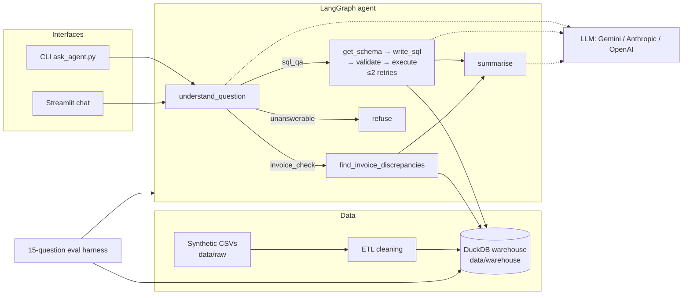

# Shipping Data Agent

Natural-language Q&A over a synthetic parcel-shipping warehouse, plus invoice-discrepancy checks. A LangGraph agent turns questions into guarded DuckDB SQL (or a curated discrepancy tool), summarises the result in plain English, and refuses when the warehouse cannot answer.

## Problem statement

Carrier operations teams need fast answers from shipment and invoice data — “how many delayed DHL parcels to Germany?”, “which invoices look wrong?” — without writing SQL or trusting an unconstrained LLM. This project builds a **read-only** agent on synthetic CSVs loaded into DuckDB: clean ETL, schema-aware SQL generation with validation and retries, specialist invoice-fault detection, offline evaluation against SQL ground truth, and a simple CLI + Streamlit chat UI.

## Architecture



| Layer | Role |
|-------|------|
| `data/raw` + `scripts/generate_synthetic_data.py` | ~20k shipments, carriers, contract rates, invoices (~3% injected faults) |
| `src/.../etl` | Clean + load star schema into DuckDB |
| `src/.../tools` | Read-only `run_sql`, `get_schema`, `find_invoice_discrepancies` |
| `src/.../agent` | Explicit LangGraph: understand → SQL path or discrepancy → summarise/refuse |
| `src/.../eval` | 15 fixed questions graded against DuckDB SQL answers |
| CLI / Streamlit | Ask questions without writing Python |

## How to run (3 commands)

```bash
cp -n .env.example .env   # set GEMINI_API_KEY=… (or GOOGLE_API_KEY / Anthropic / OpenAI)
make setup && make data && make etl
make run                  # Streamlit chat at http://localhost:8501
```

That is enough for a working UI. Useful alternatives:

```bash
make ask Q='How many shipments were delivered to Germany?'
.venv/bin/python scripts/ask_agent.py --interactive
make eval                 # live scoring when keys present; else SQL ground truth only
make test
```

### Gemini API key

1. Copy `.env.example` → `.env`.
2. Set **`LLM_PROVIDER=gemini`** (already the example default).
3. Set **`GEMINI_API_KEY=`** *or* **`GOOGLE_API_KEY=`** (the factory accepts either; do not commit real keys).
4. Optional: `GEMINI_MODEL=gemini-flash-lite-latest` (default; stable Flash-Lite alias).

Anthropic (`ANTHROPIC_API_KEY`) and OpenAI (`OPENAI_API_KEY`) paths still work if you set `LLM_PROVIDER` accordingly. Keys are never hardcoded.

## Example Q&A

| Question | Expected behaviour |
|----------|--------------------|
| *How many shipments were delivered to Germany?* | SQL analytics → count from `fact_shipments` (ground truth **1472**) |
| *Find invoice discrepancies and summarise the error types* | Routes to `find_invoice_discrepancies` (duplicate / wrong weight / over-contract / nonexistent) |
| *What is the weather in Berlin?* | **Refuse** — warehouse cannot answer |

```bash
make ask Q='Find invoice discrepancies and summarise the error types'
```

## Layout

```
src/shipping_data_agent/
  agent/     # LangGraph + LLM factory (Anthropic / OpenAI / Gemini)
  eval/      # 15-question bank + grading harness
  tools/     # Read-only SQL / schema / discrepancy tools
  etl/       # Cleaning + DuckDB load
scripts/     # generate_synthetic_data, run_etl, ask_agent, run_eval, streamlit_app
data/raw/    # Source CSVs
data/warehouse/  # DuckDB + rejected_rows.csv
data/eval/   # Eval results JSON
tests/
```

## Evaluation (Step 6)

Fifteen fixed questions with answers computed directly in SQL against DuckDB. The harness runs the LangGraph agent (when LLM keys are set), grades free-text answers against those ground-truth values, and reports accuracy, failed cases, and average SQL retries.

### How to run

```bash
cp -n .env.example .env   # set GEMINI_API_KEY (or ANTHROPIC/OPENAI)
make etl                 # ensure warehouse exists
make eval                # live agent scoring when keys present
# or ground-truth only (no LLM):
.venv/bin/python scripts/run_eval.py --ground-truth-only
```

Results JSON: `data/eval/results.json` (last run: `2026-10-31T21:17:30.249916+00:00`).

### How to read these results

The 15 scored questions are fixed and fairly simple (mostly counts and aggregates). The grader was adjusted once after the first live run to accept humanized labels and number formats (see the `notes` field in `data/eval/results.json`). The score shows the pipeline works end to end. It does not mean the agent is production-ready.

### Latest metrics

| Metric | Value |
|--------|-------|
| Questions | 15 |
| Accuracy | 100.0% (15/15) |
| Failed | 0 |
| Average SQL retries | 0.00 |
| LLM configured | True |

All live cases passed.

### Question bank (SQL ground truth)

| ID | Intent | Question | Expected (from DuckDB) |
|----|--------|----------|------------------------|
| `q01_shipment_count` | sql_qa | How many shipments are in the warehouse? | `20000` |
| `q02_delivered_germany` | sql_qa | How many shipments were delivered to Germany? | `1472` |
| `q03_invoice_count` | sql_qa | How many invoices are there? | `19679` |
| `q04_total_billed` | sql_qa | What is the total billed amount across all invoices in EUR, rounded to 2 decimal places? | `624580.26` |
| `q05_avg_delivery_by_carrier` | sql_qa | What is the average delivery_days by carrier, excluding cancelled shipments, rounded to 2 decimals? | `carrier_id=DHL, avg_delivery_days=6.68; carrier_id=FDX, avg_delivery_days=6.57; carrier_id=GLS, avg_delivery_days=6.65; carrier_id=TNT, avg_delivery_days=6.6; carrier_id=UPS, avg_delivery_days=6.56` |
| `q06_top_carriers_by_shipments` | sql_qa | List the top 5 carriers by shipment count with their counts. | `carrier_id=FDX, shipment_count=4068; carrier_id=TNT, shipment_count=4002; carrier_id=UPS, shipment_count=3998; carrier_id=DHL, shipment_count=3979; carrier_id=GLS, shipment_count=3953` |
| `q07_delayed_count` | sql_qa | How many shipments have status delayed? | `1437` |
| `q08_avg_weight` | sql_qa | What is the average shipment weight_kg, rounded to 2 decimals? | `16.74` |
| `q09_carrier_dim_count` | sql_qa | How many carriers are in the carrier dimension? | `5` |
| `q10_shipments_2024` | sql_qa | How many shipments were shipped in calendar year 2024? | `10109` |
| `q11_dhl_invoices` | sql_qa | How many invoices were billed by DHL? | `3929` |
| `q12_top_parcel_type` | sql_qa | What is the most common parcel_type and how many shipments use it? | `parcel_type=medium_box, n=5981` |
| `q13_max_weight` | sql_qa | What is the maximum shipment weight_kg, rounded to 2 decimals? | `119.99` |
| `q14_contract_rate_rows` | sql_qa | How many contract rate rows are in the warehouse? | `250` |
| `q15_invoice_discrepancies` | invoice_check | Find invoice discrepancies and report the count for each error type (duplicate_billing, wrong_weight_class, price_above_contract, nonexistent_shipment). | `duplicate_billing=292, nonexistent_shipment=145, price_above_contract=145, wrong_weight_class=146` |
## Limitations

- Latest live eval is **15/15 (100%)** with Gemini Flash-Lite; free-tier model quotas can still throttle demos (prefer `gemini-flash-lite-latest` over exhausted Flash SKUs).
- Heuristic intent routing can misclassify edge-case questions; LLM classification helps only when a key is set.
- SQL answers depend on the model writing valid, schema-aligned SELECT statements (guards + ≤2 retries mitigate but do not eliminate failures).
- Synthetic data and a fixed seed. Not production carrier feeds. The seed CSVs are structurally clean, so ETL rejects 0 rows on a real run; cleaning rules are checked by unit tests with deliberately broken input (`tests/test_etl_cleaning.py`), not by real-world dirty data.
- Streamlit UI is a thin chat shell (no auth, history persistence, or multi-user sessions).
- Single local DuckDB file; no concurrent write workload design.

## What I would do next

1. Expand the eval to 50+ questions, including harder ones (multi-table joins, relative date periods, ambiguous wording).
2. Persist chat history and show the SQL / tool used under each answer in the UI.
3. Add a small retrieval or schema-card cache so write_sql stays stable as the warehouse grows.
4. Expand the discrepancy tool with dollar impact and shipment-level drill-down.
5. Package as a small Docker Compose stack (warehouse volume + Streamlit) for demos.
